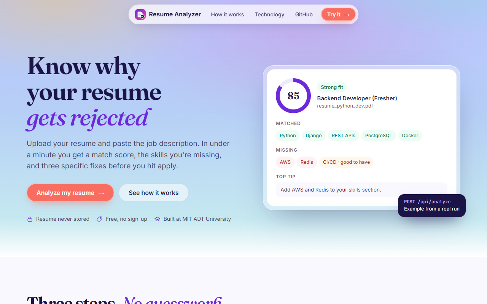
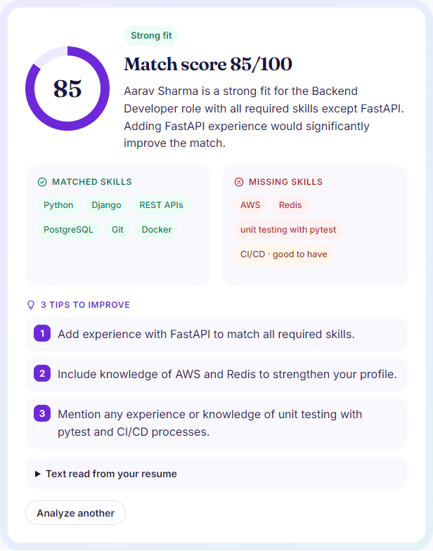

# Resume Analyzer (LLM Mini Project, PS 41)

**Name:** Virendra Dilip Mahajan | **Roll No:** 41 | **Enrollment:** ADT23SOCB1322 | **Class:** LY Core 4

## Problem statement
Students don't know why their resumes get rejected. This app compares a resume
with a job description and gives a **match score**, **matched skills**,
**missing skills** and **3 tips** to improve.

## Live website
**https://resumeanalyzer-flax.vercel.app**

## How it works
1. Upload a resume PDF on the web page; the browser reads its text with pdf.js (the file never leaves your computer).
2. Paste the job description.
3. The text and JD go to a small Flask API on Vercel (`app.py`), which sends them to the LLM with a strict prompt that asks for JSON (`match_score`, `matched_skills`, `missing_skills`, `tips`, `summary`).
4. The JSON is checked in Python (`analyzer.py`: score clamped to 0-100, one retry if the JSON is broken, "A or B" skills fixed), then shown on the page.

**Model:** Qwen2.5-14B-Instruct (Q4_K_M), served by llama.cpp `llama-server` on a slice of an NVIDIA H200 GPU in the MIT ADT Baramati AI lab (node 04). Vercel reaches it over HTTPS through a Cloudflare tunnel; the server requires a secret API key. Any OpenAI-compatible endpoint works by changing `LLM_BASE_URL`, `LLM_MODEL` and `LLM_API_KEY`.

## How to run locally
```
pip install -r requirements.txt
# point to any OpenAI-compatible LLM (see .env.example)
python app.py        # then open http://127.0.0.1:8541
```
Run the 5 test cases: `python tools/run_tests.py` (results go to `test_results.md`).

## Screenshots



## Test results
| Resume | Job description | Expected | Score |
|---|---|---|---|
| Python developer | Backend developer | strong | 85 |
| Python developer | Frontend (React) | partial | 30 |
| Data analyst | Data analyst | strong | 85 |
| Data analyst | ML engineer | partial | 65 |
| Mechanical engineer | Backend developer | weak | 0 |

Sample resumes are fictional and are generated by `tools/make_samples.py`.
