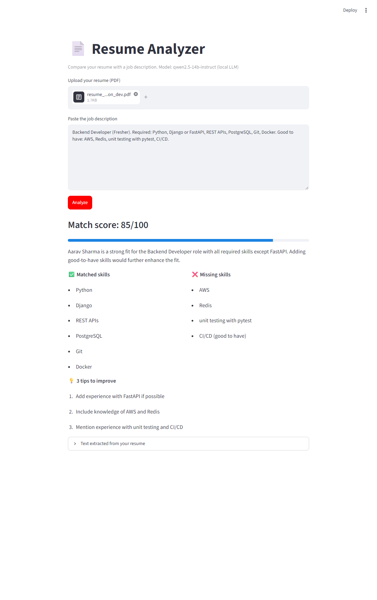
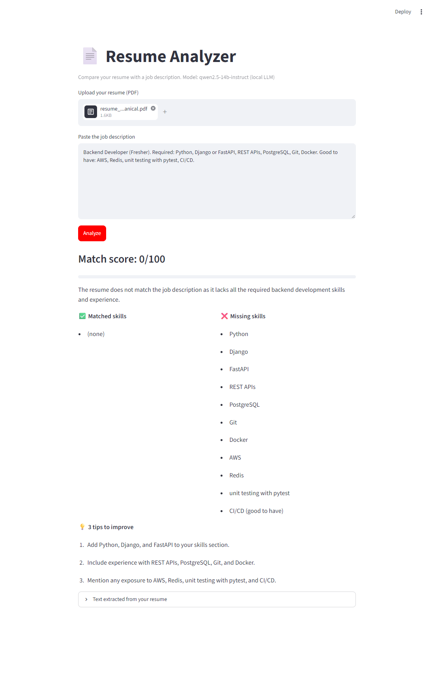

# Resume Analyzer (LLM Mini Project, PS 41)

**Name:** Virendra Dilip Mahajan | **Roll No:** 41 | **Enrollment:** ADT23SOCB1322 | **Class:** LY Core 4

## Problem statement
Students don't know why their resumes get rejected. This app compares a resume
with a job description and gives a **match score**, **matched skills**,
**missing skills** and **3 tips** to improve.

## How it works
1. Upload a resume PDF; the text is extracted with PyPDF2.
2. Paste the job description.
3. The resume and JD are sent to an LLM with a strict prompt that asks for JSON
   (`match_score`, `matched_skills`, `missing_skills`, `tips`, `summary`).
4. The JSON is checked in Python (score clamped to 0-100, one retry if the JSON
   is broken, "A or B" skills fixed), then shown in Streamlit with `st.progress`.

**Model:** Qwen2.5-14B-Instruct (Q4_K_M), served by llama.cpp `llama-server`
on an NVIDIA RTX PRO 6000 GPU in the MIT ADT Baramati AI lab. The code uses the
OpenAI-compatible API, so it also works with Groq, OpenAI or Ollama by changing
`LLM_BASE_URL`, `LLM_MODEL` and `LLM_API_KEY`.

## How to run
```
pip install -r requirements.txt
# point to any OpenAI-compatible LLM (see .env.example), e.g. Ollama:
#   set LLM_BASE_URL=http://localhost:11434/v1   set LLM_MODEL=qwen2.5:14b
streamlit run app.py
```
Run the 5 test cases: `python tools/run_tests.py` (results go to `test_results.md`).

## Screenshots



## Test results
| Resume | Job description | Expected | Score |
|---|---|---|---|
| Python developer | Backend developer | strong | 85 |
| Python developer | Frontend (React) | partial | 30 |
| Data analyst | Data analyst | strong | 85 |
| Data analyst | ML engineer | partial | 65 |
| Mechanical engineer | Backend developer | weak | 0 |

Sample resumes are fictional and are generated by `tools/make_samples.py`.
